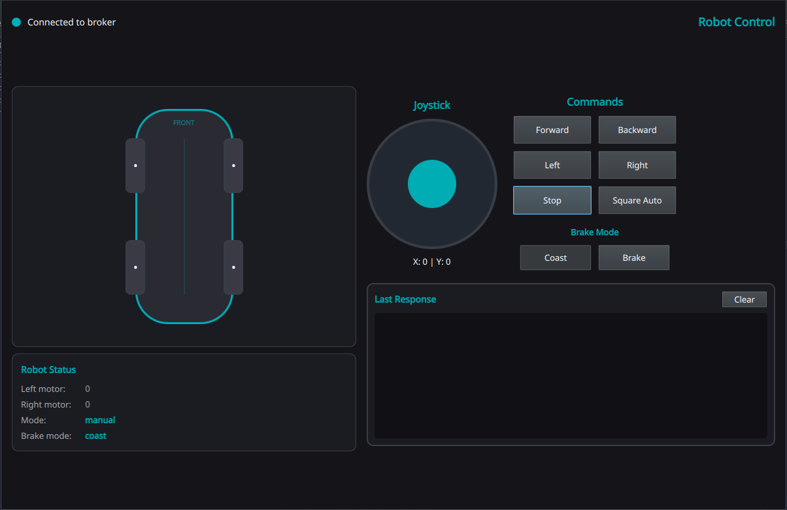

# Robot Mqtt Control App (GUI)

## Python environment setup
After cloning this repo create a python virtual environment (venv) and install python dependencies.

```text
pip install -r requirements.txt
```

## Application execution
```text
python main.py
```
You should now see the robot's main control panel. The connection to the MQTT broker may not be available.


